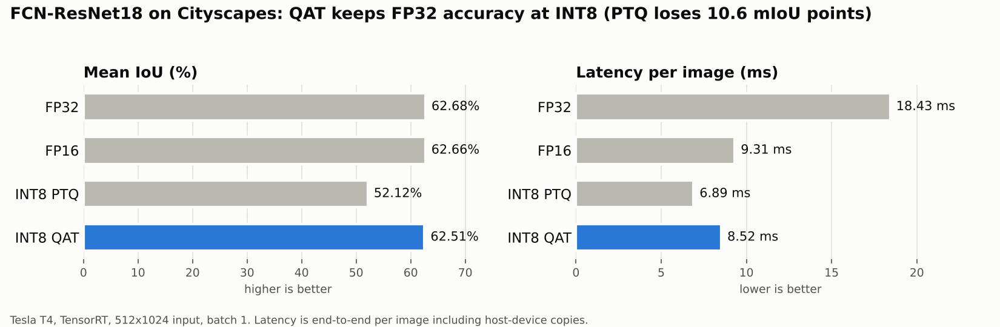
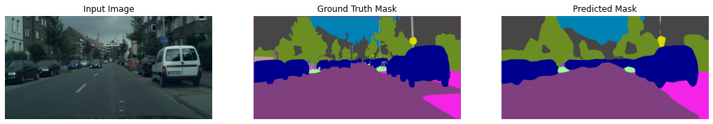

# INT8 Quantization-Aware Training for Semantic Segmentation (TensorRT)

FCN-ResNet18 trained on **Cityscapes** and deployed as **TensorRT** engines in FP32, FP16 and INT8.
The point of the project: naive post-training quantization breaks a dense-prediction model, and
**quantization-aware training (QAT)** fixes it.

**Headline (Tesla T4, 512×1024):** INT8 PTQ drops mean IoU by **10.6 points** (62.68% → 52.12%).
INT8 QAT recovers it to **62.51%** (−0.17 points vs FP32) while running **2.2× faster than FP32**
(18.43 → 8.52 ms per image).



## Results

Cityscapes validation, 19 classes, 512×1024 input, batch 1, Tesla T4. Latency is end-to-end per
image through a PyCUDA inference loop, including host↔device copies.

| Engine | Pixel accuracy | Mean IoU | Latency | Throughput | Engine size |
|---|---:|---:|---:|---:|---:|
| FP32 | 92.24% | 62.68% | 18.43 ms | 54.3 img/s | 78.53 MB |
| FP16 | 92.24% | 62.66% | 9.31 ms | 107.4 img/s | 25.12 MB |
| INT8 PTQ (implicit, TensorRT calibrator) | 81.84% | 52.12% | 6.89 ms | 145.2 img/s | 12.81 MB |
| **INT8 QAT (explicit Q/DQ)** | **92.20%** | **62.51%** | **8.52 ms** | **117.3 img/s** | not recorded |

**Takeaways**
- FP16 is effectively lossless here and already halves latency.
- Plain INT8 PTQ is the fastest engine but costs over 10 mIoU points, which is too much for
  segmentation, where errors land on thin and rare classes.
- QAT brings INT8 back to FP32 accuracy. Its explicit Q/DQ engine is slower than the implicit PTQ
  engine (8.52 vs 6.89 ms) and only modestly faster than FP16 (9.31 ms), so the next step is
  profiling which layers TensorRT keeps outside INT8 and fusing them.

### Example: INT8 QAT engine prediction



## How it works

1. **Model:** FCN head on a ResNet18 backbone (torchvision `IntermediateLayerGetter`), 19 Cityscapes
   classes, trained at 512×1024 with Albumentations augmentation and class-weighted cross-entropy
   to counter class imbalance.
2. **FP32 / FP16:** ONNX export and `trtexec` engine builds.
3. **PTQ:** implicit INT8 with a TensorRT entropy calibrator.
4. **QAT:** NVIDIA `pytorch-quantization` fake-quant layers, histogram calibration (99.9th percentile),
   5 epochs of fine-tuning, Q/DQ ONNX export (opset 13) and an explicit-precision INT8 engine.
5. **Evaluation:** a PyCUDA TensorRT runtime loop computing pixel accuracy, per-class IoU and mean
   IoU, latency and throughput.

## Repository layout

```
notebooks/
  fcn_resnet18_cityscapes_qat.ipynb   # full pipeline, cleaned; recorded results table at the end
assets/                               # figures used in this README
requirements.txt
```

## Reproduce

Run on Kaggle with a GPU accelerator and the Cityscapes dataset (`leftImg8bit` + `gtFine`) attached.
Run the setup cell, then the notebook top to bottom; set `INPUT_DIR` / `WORK_DIR` in the first cell
if you are not on Kaggle. Outside Kaggle you need an NVIDIA GPU, CUDA and a matching TensorRT install
(see `requirements.txt`).

> The notebook was cleaned for readability after the recorded run and has not been re-executed since,
> so it ships without outputs. Results above come from the run logged in March 2025.

## Tech

PyTorch · TensorRT · ONNX · NVIDIA pytorch-quantization · PyCUDA · Albumentations · trtexec

## Related

- [TensorRT-Quantization-ImageClassification](https://github.com/namrathasanjay/TensorRT-Quantization-ImageClassification):
  PTQ vs QAT and per-layer sensitivity analysis for MobileNetV2.
